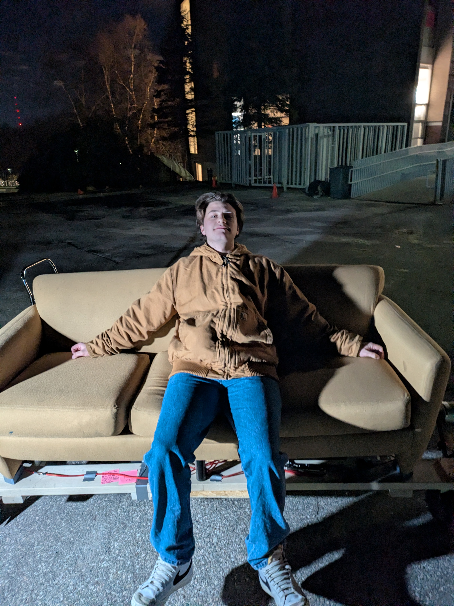
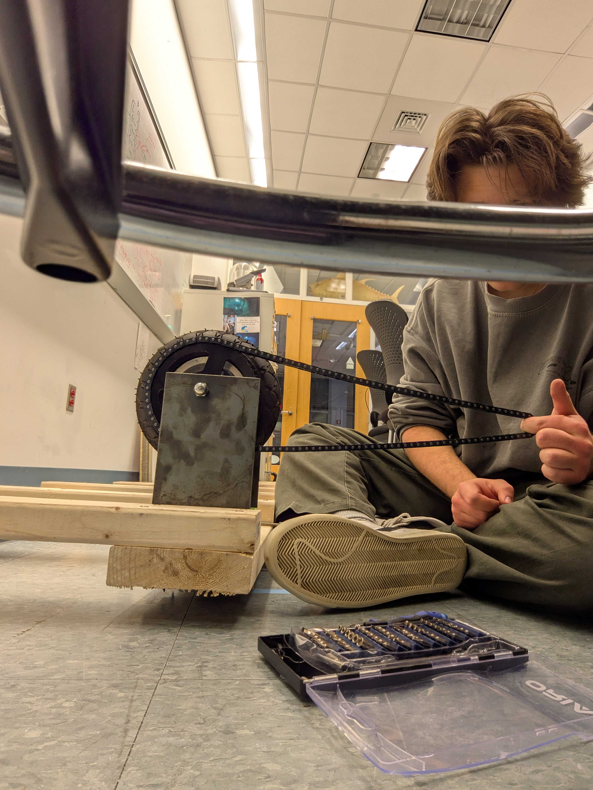
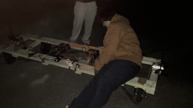
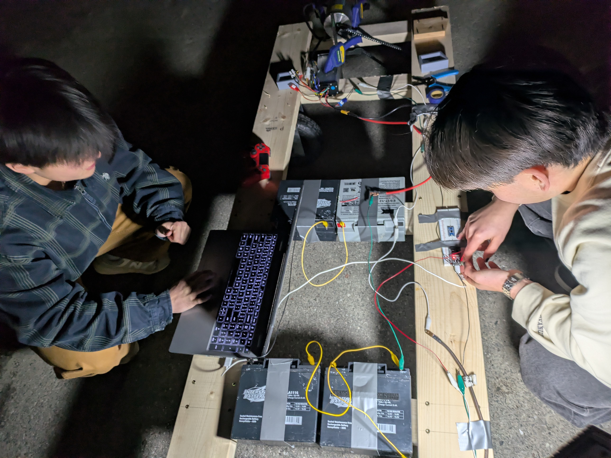

_**Skills Used:**_
 - **_Cast Urethane Mold Design_**
 - **_Vacuum Form Mold Design_**
 - _**Plastic Materials Selection**_
 - _**Molded Plastics Manufacturing**_
 - **_Stratasys 3D Printing, Vapor Smoothing Post-processing_**

  
  
  
  

 
[For pictures of our process... →](https://photos.app.goo.gl/7cwMRmoLqXJ7hbur7)

[Back to all projects →](https://cooperpenkava.github.io/projects/)
