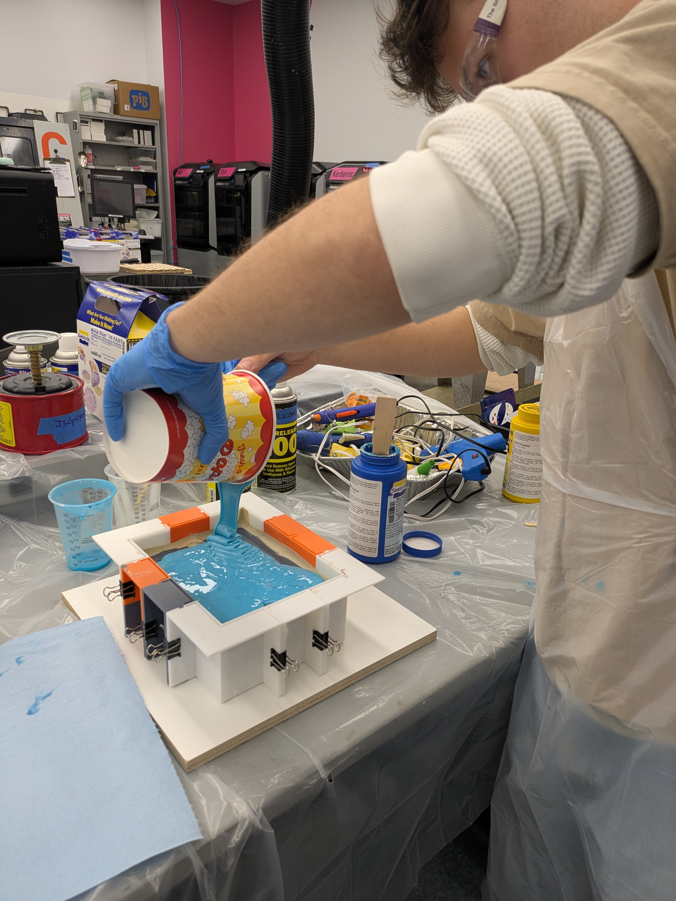
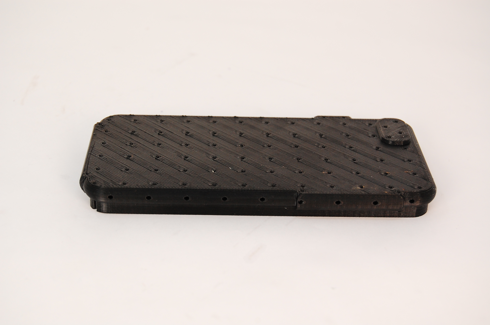
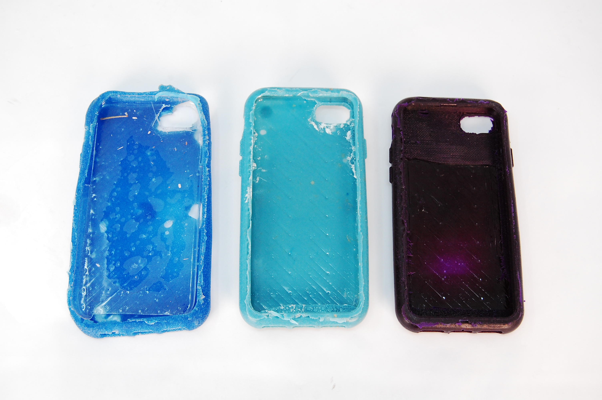
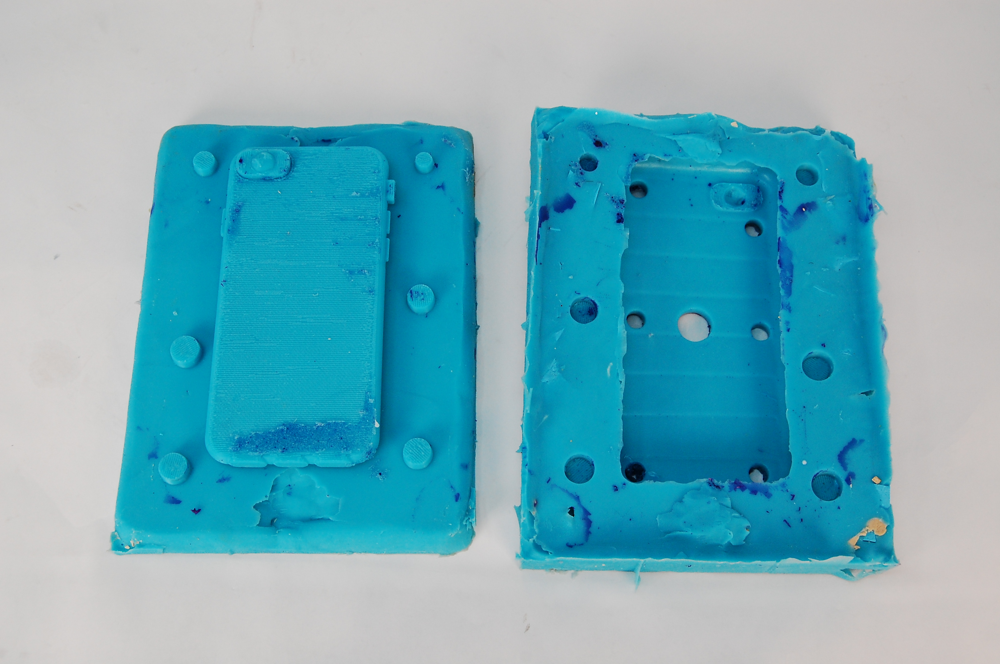

_**Skills Used:**_
 - **_Cast Urethane Mold Design_**
 - **_Vacuum Form Mold Design_**
 - _**Plastic Materials Selection**_
 - _**Molded Plastics Manufacturing**_
 - **_Stratasys 3D Printing, Vapor Smoothing Post-processing_**

  
  
  
  

For my Design for Manufacturing class, another student and I made a phone case for an iPhone SE Gen 3. 

We wanted a two part case that would protect the phone, comprising of one hard plastic inner piece and a soft urethane outer piece. To achieve this, we set the following design requirements:
 - phone does not break in any form when dropped from hip height
 - phone can be held from case at any angle *without falling out*
 - must have a vacuum formed plastic piece (class requirement)
 - must have a cast urethane piece (class requirement)
 - cast part volume must be less than 7 in^3

For the Vacuum Form Part, we wanted the phone to click into it, so we attempted to get as close to the negative draft angle of the phone as possible. To achieve this, we had lots of holes in our mold, and we took advantage of 3D printings unique capabilities to make holes that from the bottom, where the vacuum was pulling from, to the side, where we wanted the PETG sheet to conform as much as possible.
For the silicone mold, we created two 3D printed parts. One flat plate, with a hollow section below the plate that represented the shape of the phone. We stuck this plate to a mold making set up with clay to seal it completely, and then fill it up until the silicone mold completely filled the phone negative and then some height above that. The second 3D printed part was a positive representation of the case itself, along with positives of the fill holes and vent holes. We vapor smoothed it for a nice finish, free of layer lines. We then put this 3D printed piece over the positive phone shape created by the previous mold, sprayed with mold release, and then poured our silicone until it rose up past the phone case. This technically put our parting line not in the middle of the part but at the very end of the part's lip, which worked fine for our design because both the silicone mold itself and the phone case we would be making were elastic enough to stretch the lip off of the silicone phone mold. This not only worked but also prevented an ugly parting line.
When casting, we would mold release the silicone mold, then take a vacuum formed piece (cut from the sheet) and put it over the silicone positive phone shape. We discovered that our urethane was too viscous to flow through the funnels fast enough to fill the mold before its pot life was up, so after the first attempt, we just poured it into the top mold and smashed the bottom into the pool of resin, and then we put it into a vacuum chamber to remove bubbles and move the liquid to all parts of the mold. 

It took 3 casts, but our third finally worked! The first involved finding out it was too viscous to use the funnels and inlet holes, the second, we changed plastics, but it came out much too rigid, and the third we changed back again, and it was just right. The vacuum form plastic created better than a (virtually) zero degree draft, even despite the side holes, but this still fit within our design, because the soft urethane went over in and kept that in place while holding onto the phone.

There were three main challenges we faced in designing this phone case:
1. Negative Drafts/Lip
   The first of these problems was that we wanted to produce a shape that had a hollow hemicircle cross section - this required some thoughtful design work and materials that could withstand some deflection. We addressed this with the vacuum formed piece with holes that routed to the side, as mentioned above. And for the silicone mold, again, as mentioned above, we wanted to get rid of an ugly parting line, so we had the entire positive phone volume on one half of the mold and the entire negative of the phone case on the other. Both of these parts, though, needed material choices to fit our design.
2. Material Choice
   Material choice was paramount to the success of this project. For the vacuum formed plastic piece, we used a sheet of PETG, which of the materials we had in house, was going to give us the best chance of melt around the 3D printed mold and, for the same reasons, would be most compliant, allowing a little flexture when removing it from the mold. We wanted a soft plastic to absorb impacts when dropping the phone. We also wanted this to accommodate the parting line placement mentioned above, which required a material that could stretch or flex off of the phone shape. We initially identified Eco-Flex 30 based on its durometer, but we double checked it with an Eco-Flex sampler, and found that Eco-Flex 40 was a bit more preferable in that it felt less gummy, had picked up less dust over years of use, and was still squishy enough to achieve our design goals.  
3. Pot Life
   Unfortunately, we needed to move quickly. Eco-Flex has a pot life of 3 minutes. This meant that we had to organize our workspace very well, and also that waiting for the viscous material to flow through the small funnels was a non option. This is why we opted for the "pour and smash" method and then rapidly put it into the vacuum chamber to remove bubbles as quickly as possible. 
 
[For pictures of our process... →](https://photos.app.goo.gl/7cwMRmoLqXJ7hbur7)

[Back to all projects →](https://cooperpenkava.github.io/projects/)
